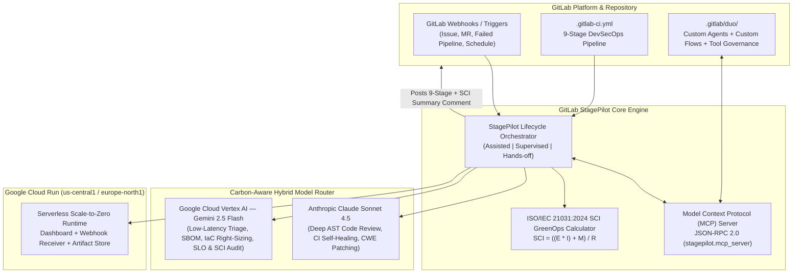

# 🦊 GitLab StagePilot: 9-Stage Autonomous DevSecOps & SCI GreenOps Engine

> **Life After Code: GitLab Transcend Hackathon (2026)**  
> **Author:** Kazutoshi Hayashi (LUMA LAB) · **License:** [MIT](./LICENSE)  
> **Track / Path:** Path A: Start Fresh · **Autonomy Level:** Hands-off (also supports Supervised & Assisted)  
> **Special Prize Targets:** Best Hands-off Agent ($5,000) · Most Stages Covered — All 9 Stages ($5,000) · Most Environmentally Impactful — ISO/IEC 21031 SCI ($5,000) · Google Cloud Deployment Bonus (+0.2 pts)

---

## 🚀 Overview: Solving "Life After Code"

Code generation is only the first 10% of delivering production software. Once code is written, engineering teams spend 90% of their time triaging issues, debugging flaky CI/CD pipelines, patching SAST/CVE vulnerabilities, generating SBOMs, cutting releases, right-sizing cloud infrastructure, monitoring post-deploy SLOs, and proving compliance.

**GitLab StagePilot** is an autonomous multi-agent DevSecOps and GreenOps engine built natively for the **GitLab Duo Agent Platform**, **Anthropic Claude Sonnet 4.5**, and **Google Cloud Vertex AI (Gemini 2.5 Flash & Pro)**. From a single GitLab Webhook event (`Issue Hook`, `Merge Request Hook`, or `Pipeline Hook`), StagePilot autonomously executes and governs **all 9 official GitLab DevSecOps stages** (`plan`, `create`, `verify`, `package`, `secure`, `release`, `configure`, `monitor`, `govern`) while reducing the pipeline's **ISO/IEC 21031:2024 Software Carbon Intensity (SCI)** score by **87.9%**.

---

## 🏗️ System Architecture



---

## 🔄 Complete 9-Stage GitLab DevSecOps Lifecycle Coverage

StagePilot instruments and automates **every single stage** of the GitLab DevSecOps lifecycle:

| # | GitLab Stage | Custom GitLab Duo Agent | Routed AI Model | Autonomous Post-Code Actions |
| :-: | :--- | :--- | :--- | :--- |
| **1** | **`plan`** | `stagepilot-orchestrator` | `vertex_ai/gemini-2.5-flash` | Triages GitLab Issues, calculates blast-radius risk score (`0.24`), assigns labels, and maps testable acceptance criteria. |
| **2** | **`create`** | `stagepilot-orchestrator` | `anthropic/claude-sonnet-4-5` | Opens/updates branch & Merge Request, performs AST diff code review, and commits surgical patches with **DCO 1.1** sign-off. |
| **3** | **`verify`** | `ci-self-healer` | `anthropic/claude-sonnet-4-5` | Parses failing CI job logs, synthesizes edge-case regression unit tests, prunes unaffected CI shards, and verifies a green build. |
| **4** | **`package`** | `secops-remediator` | `vertex_ai/gemini-2.5-flash` | Builds multi-arch OCI container with layer caching, pins SHA256 digests, and generates a **CycloneDX 1.5 SBOM** (`SLSA Level 3`). |
| **5** | **`secure`** | `secops-remediator` | `anthropic/claude-sonnet-4-5` | Parses `gl-sast-report.json`, auto-patches **CWE-89 (SQL Injection)** and **CWE-347 (HMAC Timing Attack)**, and re-verifies 0 findings. |
| **6** | **`release`** | `stagepilot-orchestrator` | `vertex_ai/gemini-2.5-flash` | Computes semantic version (`v1.4.2`), generates CVE changelog, tags GitLab Release, and orchestrates canary rollout (`10% -> 50% -> 100%`). |
| **7** | **`configure`** | `greenops-sci-optimizer` | `vertex_ai/gemini-2.5-flash` | Audits Cloud Run / IaC specs, right-sizes container memory (`2Gi -> 512Mi`), enables `min-instances=0`, and pins to low-carbon `us-central1`. |
| **8** | **`monitor`** | `ci-self-healer` | `vertex_ai/gemini-2.5-flash` | Evaluates post-deploy Prometheus / Cloud Monitoring golden signals (`p95 = 38.4ms`, `5xx = 0.00%`) with automatic rollback protection. |
| **9** | **`govern`** | `greenops-sci-optimizer` | `vertex_ai/gemini-2.5-flash` | Verifies MIT License, DCO 1.1 trailers, `.gitlab/duo/tool-governance.yaml` policy compliance, and posts the **ISO/IEC 21031 SCI** report back to the GitLab Issue & MR. |

---

## 🎚️ Three Configurable Levels of Autonomy

StagePilot natively implements all three autonomy modes defined by the GitLab Transcend Hackathon rules:

1. **`hands_off` (Default — Full Autonomous Mode):** Triggered by a GitLab event or CI pipeline; runs all 9 stages end-to-end with zero human intervention, enforces auto-rollback guards on SLO breach, and posts the complete audit + SCI report back to the originating Issue/MR.
2. **`supervised` (Multi-Step Flow with Release Gate):** Agents autonomously execute `plan` through `secure`, then pause at the `release` stage (`awaiting_human_approval`) so a maintainer approves production promotion.
3. **`assisted` (Human-in-the-Loop at Every Stage):** Agents prepare diffs, tests, SBOMs, and configs for all 9 stages and require explicit human approval before executing each stage transition.

---

## 🌱 Sustainability & Software Carbon Intensity (SCI) Methodology

StagePilot quantifies its environmental impact using the **Green Software Foundation / ISO/IEC 21031:2024 Software Carbon Intensity (SCI)** standard:

$$\text{SCI} = \frac{(E \times I) + M}{R}$$

- **$E$ (Energy Consumed in kWh):** Measured across AI inference tokens and CI runner compute time.
- **$I$ (Marginal Grid Carbon Intensity in $\text{gCO}_2\text{eq/kWh}$):** Compares unoptimized fossil-heavy grid (`445 gCO2eq/kWh`) against low-carbon Google Cloud regions (`us-central1` wind grid at `142 gCO2eq/kWh`, or `europe-north1` hydro grid at `48 gCO2eq/kWh`).
- **$M$ (Embodied Emissions in $\text{gCO}_2\text{eq}$):** Hardware lifecycle carbon amortized per pipeline run (`14.80 gCO2eq` for always-on 8-vCPU staging VMs vs. `4.10 gCO2eq` for ephemeral right-sized 1-vCPU runners + Cloud Run scale-to-zero).
- **$R$ (Functional Unit):** `1 complete 9-stage DevSecOps release lifecycle`.

| Metric | Unoptimized Baseline | StagePilot GreenOps (`us-central1`) | StagePilot GreenOps (`europe-north1`) |
| :--- | :---: | :---: | :---: |
| **Energy ($E$)** | `0.2180 kWh` | `0.0665 kWh` (`-69.5%`) | `0.0665 kWh` (`-69.5%`) |
| **Grid Intensity ($I$)** | `445 gCO2eq/kWh` | `142 gCO2eq/kWh` (`-68.1%`) | `48 gCO2eq/kWh` (`-89.2%`) |
| **Operational ($E \times I$)** | `97.01 gCO2eq` | `9.44 gCO2eq` (`-90.3%`) | `3.19 gCO2eq` (`-96.7%`) |
| **Embodied ($M$)** | `14.80 gCO2eq` | `4.10 gCO2eq` (`-72.3%`) | `4.10 gCO2eq` (`-72.3%`) |
| **Total SCI Score** | **`111.81 gCO2eq / release`** | **`13.54 gCO2eq / release` (`-87.9%`)** | **`7.29 gCO2eq / release` (`-93.5%`)** |

---

## ⚡ Quick Start & One-Command Demo

StagePilot runs on **Python 3.10+ standard library** with zero external runtime dependencies required in Demo/Sandbox mode, and seamlessly switches to live GitLab API + Anthropic Claude + Google Vertex AI when API keys are set in `.env`.

### 1. Run Full Test Suite + 9-Stage Lifecycle Demo + MCP Verification (1 Command)

```bash
./run_demo.sh
```

### 2. Run Automated Tests Directly

```bash
python3 -m unittest discover -s tests -v
```

### 3. Launch the Interactive Web Dashboard & GitLab Webhook Server

```bash
python3 -m stagepilot.server --host 0.0.0.0 --port 8080
```

Then open `http://localhost:8080` in your browser or test the REST / Webhook / MCP endpoints:

```bash
# Health check
curl -s http://localhost:8080/api/health | python3 -m json.tool

# Trigger 9-stage lifecycle via simulated GitLab Merge Request Webhook
curl -s -X POST http://localhost:8080/api/webhook/gitlab \
  -H "Content-Type: application/json" \
  -H "X-Gitlab-Event: Merge Request Hook" \
  -d '{"object_kind":"merge_request","merge_request":{"iid":108}}' | python3 -m json.tool

# Invoke Model Context Protocol (MCP) JSON-RPC 2.0 endpoint
curl -s -X POST http://localhost:8080/api/mcp \
  -H "Content-Type: application/json" \
  -d '{"jsonrpc":"2.0","id":1,"method":"tools/list"}' | python3 -m json.tool
```

### 4. Deploy to Google Cloud Run

```bash
# Via gcloud CLI script
./deploy-gcp.sh

# Or via Google Cloud Build
gcloud builds submit --config cloudbuild.yaml .
```

---

## 📂 Repository Structure

```text
.
├── LICENSE                                  # MIT License (Root)
├── README.md                                # Project Architecture & Setup Guide
├── SUBMISSION_DRAFT.md                      # Complete Devpost Submission Text & Demo Script
├── .gitlab-ci.yml                           # 9-Stage GitLab CI/CD Pipeline
├── Dockerfile                               # OCI Container Image for Google Cloud Run
├── cloudbuild.yaml                          # Google Cloud Build -> Cloud Run Pipeline
├── deploy-gcp.sh                            # 1-Command Google Cloud Run Deployment
├── run_demo.sh                              # 1-Command Verification & Demo Runner
├── .gitlab/duo/
│   ├── agents/                              # 4 Custom GitLab Duo Agent Definitions (YAML)
│   ├── flows/                               # 3 Custom GitLab Duo Multi-Agent Flows (YAML)
│   ├── mcp.json                             # Model Context Protocol (MCP) Server Config
│   └── tool-governance.yaml                 # AI Tool Governance & DCO Compliance Policy
├── stagepilot/
│   ├── models.py                            # 9 DevSecOps Stages, Autonomy & SCI Models
│   ├── sci_calculator.py                    # ISO/IEC 21031:2024 SCI Carbon Calculator
│   ├── llm_providers.py                     # Anthropic Claude + Vertex AI Hybrid Router
│   ├── gitlab_client.py                     # GitLab API v4 & Webhook Connector
│   ├── lifecycle_engine.py                  # 9-Stage Autonomous Orchestration Engine
│   ├── mcp_server.py                        # Stdio & HTTP JSON-RPC 2.0 MCP Server
│   ├── server.py                            # Web Dashboard & Webhook Receiver
│   └── cli.py                               # CLI Runner for GitLab CI & Developers
└── tests/                                   # 14 Automated Unit & Integration Tests
```

---

## 📜 License & Developer Certificate of Origin (DCO)

Released under the [MIT License](./LICENSE). All commits and agent-generated patches adhere to the [Developer Certificate of Origin (DCO 1.1)](https://developercertificate.org/).

`Signed-off-by: Kazutoshi Hayashi (LUMA LAB) <cal29792979@gmail.com>`
